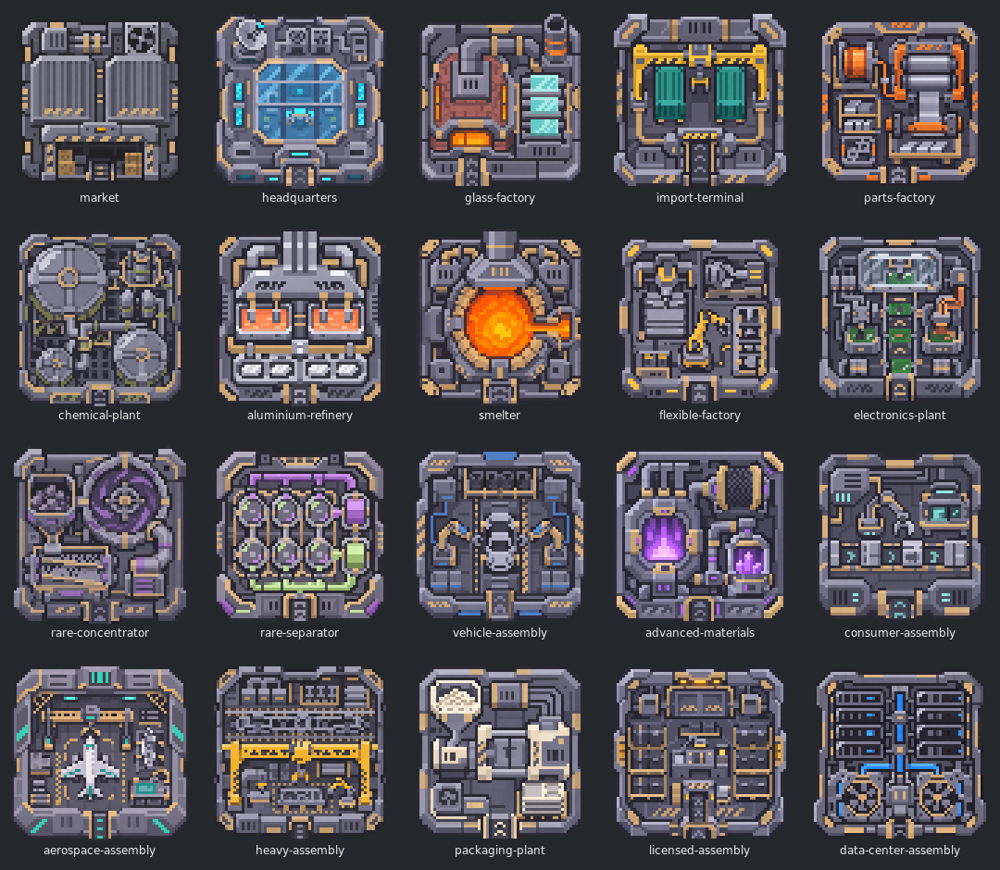

# 고요한 시장 · 기업 경영 0.2.1

Mindustry **160.7**, 세르플로 **싱글플레이**용 산업·기업 경영 모드.
적 없는 캠페인에서 원료를 채굴하고, 중간재와 완제품을 생산·판매하며 지역을 개방합니다.

**완제품 28종 · 전체 신규 아이템 82종 · 가공법 66개 · 공장 17종**을 제공합니다.

## 0.2.1 건물 디자인

공장 17종과 판매소·기업 본부·수입처를 설비별 도트 디자인으로 교체했습니다. 64×64 픽셀, 기존 2×2 설치 면적을 유지합니다. 생산·경제 규칙과 저장 형식은 바뀌지 않습니다.

## 설치와 시작

게임의 **모드 → GitHub에서 가져오기**에 `Syun0121-stack/peaceful-market`을 입력하고 완전히 재시작합니다.

1. 구리와 납을 모아 **판매소**를 건설합니다. 판매 수익은 **기업 계좌**에 적립됩니다.
2. 기술 트리에서 **기초 금속 가공소**를 연구하고 건설합니다.
3. 공장을 눌러 **구리 전선**을 선택하고 구리를 투입합니다. 생산품을 컨베이어로 판매소에 보냅니다.
4. 첫 지역에서 **누적 매출 600크레딧 + 구리 전선 40개 생산·판매**를 달성합니다.
5. 판매소의 **기업 본부 → 지역 개방**에서 다음 지역을 구매하고 행성 화면에서 출발합니다.

공장 연구에는 원료·중간재가 필요합니다. 다음 지역에서 신규 광맥을 채굴하거나 해금된 자원을 수입하여 연구합니다.
기존 기술 트리의 지역 연구를 이용할 때는 기업 본부에서 연구용 크레딧을 코어로 인출합니다.

## 제품

| 구분 | 완제품 |
|---|---|
| 전자기기 4종 | 휴대폰, 태블릿, 노트북, TV |
| 가전제품 6종 | 냉장고, 세탁기, 에어컨, 전자레인지, 진공청소기, 전기밥솥 |
| 차량·중장비 6종 | 자동차, 전기자동차, 화물차, 버스, 여객열차, 굴착기 |
| 항공·선박 5종 | 여객기, 화물기, 민수 헬리콥터, 화물선, 여객선 |
| 기타 7종 | 플라스틱 일회용품, 플라스틱 포장재, 산업용 로봇, AI 데이터센터 설비, 총기 전시 상품, 비활성 탄약 상품, 전차 전시 상품 |

제품은 운송·판매하는 **아이템**이며 전투 유닛으로 소환하지 않습니다. 방산 계열은 허가 상품 키트를 사용하는 추상적인 포장 상품입니다.
전투 유닛 생산과 연구는 차단하며 코어 조작 유닛, 모노·폴리·메가는 유지합니다. 기존 전투 유닛은 지역을 불러올 때 제거합니다.

## 산업과 지역

철광석·석회석 → 철·강철, 보크사이트 → 알루미나 → 알루미늄, 원유 → 플라스틱·고무 등으로 가공합니다.
금·리튬·니켈·크로뮴·텅스텐·붕소 계열 소재도 지역별로 추가됩니다.

희토류는 **광석 → 정광 → 혼합 산화물 → 개별 산화물 → 기능성 소재**로 이어집니다.
희토류 분리기는 네오디뮴·이트륨·란타넘·세륨·디스프로슘 산화물을 함께 생산합니다.
부산물을 모두 배출해야 생산이 계속됩니다. 자석, 세라믹, 광학 유리, 연마 분말, 반도체·디스플레이에 사용합니다.

공정의 주요 단계와 재료 계열을 참고한 **게임 모델**입니다. 수량은 질량비가 아니며 실제 제조 조건·공정 전체를 재현하지 않습니다.
공정별 액체·기체, 폐기물 처리, 공장별 실제 소비전력 등은 단순화되어 있습니다. 원유는 채굴 가능한 용기 아이템으로 표현합니다.

- [전체 생산법·지역·공장 표](docs/industry-guide.md)
- [주식·인수·게임 오버 규칙](docs/company-guide.md)
- [업데이트 및 저장 호환 안내](docs/migration.md)
- [검증 방법과 확인 범위](docs/testing.md)

## 시장과 기업

- 시세는 실제 활동 시간 3분마다 **직전 가격 ±10%**, **기준가의 60~150%** 범위에서 변동합니다. 알림은 `시세 변경됨`입니다.
- **자원 수입처**에서 해금된 원료와 일부 중간재·완제품을 구매할 수 있습니다. 수입한 물건은 수입처에 보관되며 컨베이어로 배출됩니다.
- 지역 점령은 누적 매출과 지정 상품의 **현지 생산량·판매량**을 모두 확인합니다. 수입품을 되파는 것만으로 점령할 수 없습니다.
- 기업 본부에서 **4개 회사 주식**을 거래하고 배당을 받습니다. 과반 지분을 확보한 뒤 추가 비용을 내면 인수할 수 있습니다.
- 인수한 업종은 **생산속도 +15%, 가공료 -15%**입니다. 원료 소모량과 전력 규격은 바뀌지 않습니다.
- 첫 완제품 판매 후 **활동 시간 30분** 동안 해임을 유예합니다. 이후 자사 주가가 **20 미만인 결산이 3회 연속**이면 CEO 해임으로 게임 오버가 됩니다.

0.2.1은 대규모 확장의 첫 밸런스 버전입니다. 자동화 검증과 전체 캠페인을 직접 완주한 플레이테스트는 다릅니다. Android 터치·화면 배치와 장시간 경제 밸런스는 아직 확인하지 못했습니다.
